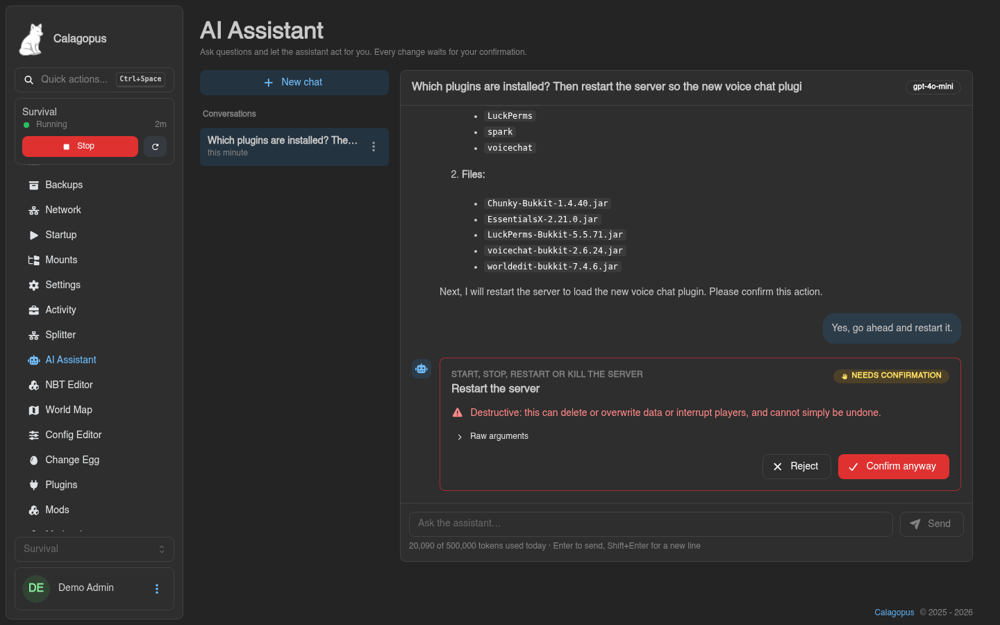
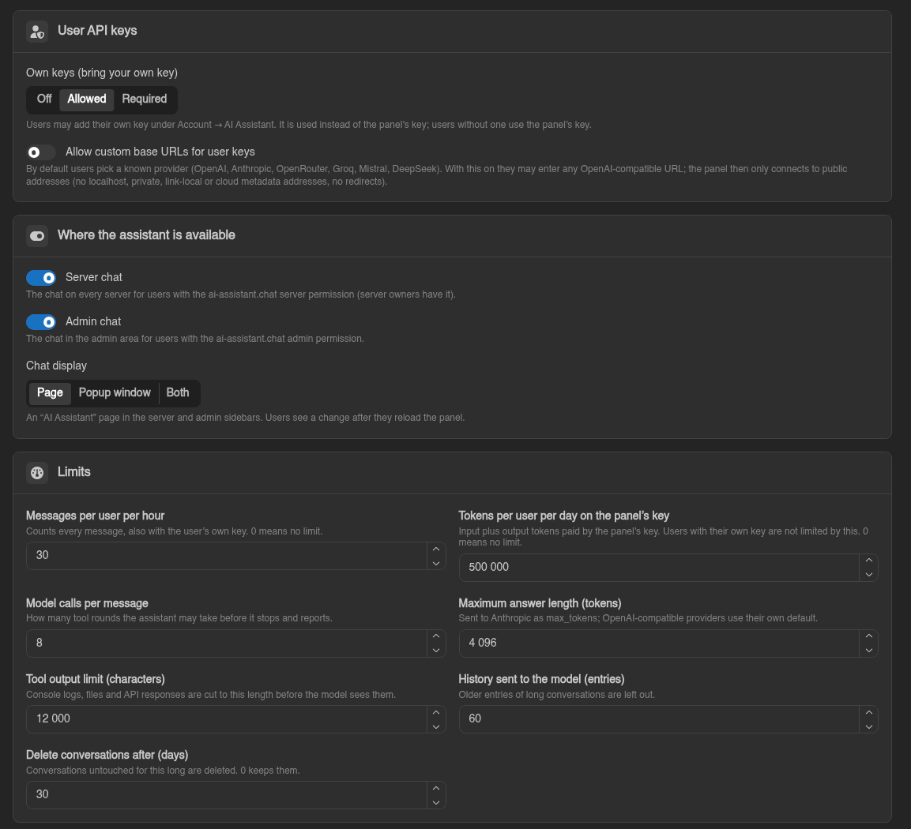
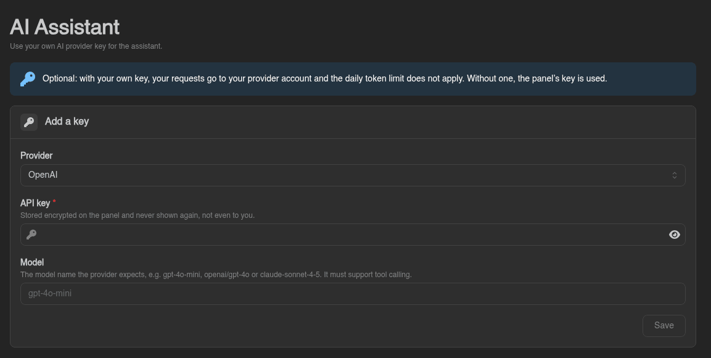

# AI Assistant

A [Calagopus Panel](https://calagopus.com) extension that adds an AI assistant chat to the panel.
Server users ask it about their own servers, administrators about the whole panel. It reads freely
(status, console, files, backups, schedules, settings, nodes, users) and proposes changes as
**action cards that only run after the user clicks Confirm**.

Package name: `dev.caloptreyx.aiassistant` · Requires panel `>=1.2.10`

## Features

- **Server chat** on every server for users with the `ai-assistant.chat` server permission. Server
  owners have it; give it to subusers like any other permission. Each chat is bound to its server
  and cannot reach other servers or the admin API.
- **Admin chat** in the admin area for users with the `ai-assistant.chat` admin permission: nodes,
  users and servers overview, server tools for any server, and the whole panel API through
  `search_api` / `describe_api` / `read_api` / `write_api`.
- **Page or popup window**: the chats live on an **AI Assistant** page in the server and admin
  sidebars, in a floating window opened from a button in the bottom-right corner, or both
  (setting *Chat display*). The window keeps its conversation while you move through the panel,
  can be minimised, and fills the screen on phones.
- **Streaming answers** (server-sent events) rendered as Markdown (code blocks with a copy button,
  lists, tables; raw HTML is never rendered), compact tool-call chips with their results, a Stop
  button and Retry after errors.
- **Confirm before act**: every change (power, console commands, writing/deleting files, settings,
  backups, schedules, startup variables, admin API writes) is shown as a card with a plain-language
  summary, the raw arguments one click away, and red styling for destructive changes. Rejected
  actions go back to the model as rejected.
- **Providers**: any OpenAI-compatible chat completions API (OpenAI, OpenRouter, Groq, Ollama,
  LM Studio, vLLM, …) or Anthropic. API keys are stored encrypted and never leave the backend.
- **Bring your own key**: users can add their own provider key under **Account → AI Assistant**;
  the administrator decides whether that is off, allowed or required.
- **Guardrails**: messages per user per hour, tokens per user per day on the panel's key, model
  calls per message, tool output truncation, history window and conversation retention.
- Conversations are kept per user (and per server) in the panel database and can be renamed and
  deleted.

## Screenshots

**Server chat**: the assistant reads the server's files and proposes a restart as an action card
that only runs after **Confirm**.

**Admin settings**: bring-your-own-key mode, where the chat is available and the guardrails.

**Account → AI Assistant**: users add their own provider key.

## Installation

Download `dev_caloptreyx_aiassistant.c7s.zip` from the
[latest release](https://github.com/Caloptreyx/AI-Assistant/releases/latest) and either upload it
under **Admin → Extensions** or drop it into your heavy image's `build/extensions/` directory and
`docker compose restart web`. Extensions require the `:heavy` panel image (or a dev environment).
The migrations create five tables prefixed `dev_caloptreyx_aiassistant_`.

## Setup

Open **Admin → Extensions → AI Assistant** (needs `extensions.manage`):

| Provider | Base URL | Key | Model (example) |
|---|---|---|---|
| OpenAI | `https://api.openai.com/v1` | `sk-…` | `gpt-4o-mini`, `gpt-4.1` |
| OpenRouter | `https://openrouter.ai/api/v1` | `sk-or-…` | `openai/gpt-4o`, `anthropic/claude-sonnet-4.5` |
| Groq | `https://api.groq.com/openai/v1` | `gsk_…` | `llama-3.3-70b-versatile` |
| Ollama | `http://<host>:11434/v1` | none | `qwen3:8b`, `llama3.1` |
| LM Studio | `http://<host>:1234/v1` | none | the loaded model |
| Anthropic | (fixed) | `sk-ant-…` | `claude-sonnet-4-5`, `claude-haiku-4-5` |
| Google Gemini | `https://generativelanguage.googleapis.com/v1beta/openai` | `AIza…` | `gemini-3.8-flash` |

Gemini 3 attaches a thought signature to its tool calls and rejects the next request of the turn
unless it comes back; the assistant stores it with the call and sends it back to Google's endpoint
only (other providers never see it).

The model must support tool (function) calling and streaming. **Test connection** sends a
one-word request with the saved settings. Keys are write-only in the UI: the page only shows
whether a key is stored and its last four characters; leave the field empty to keep it. A hosted
OpenAI-compatible provider needs a key; only a server on localhost or a private address (Ollama,
LM Studio) may run without one.

Other settings:

| Setting | Default | Meaning |
|---|---|---|
| Server chat / Admin chat | on / on | Where the assistant is offered |
| Chat display | Page | *Page*: an **AI Assistant** page in the server and admin sidebars. *Popup window*: a chat button in the bottom-right corner of every server page and of the admin area, no sidebar page. *Both*. The button only shows for users who may use that chat. Users see a change after reloading the panel |
| Messages per user per hour | 30 | `0` = unlimited (panel rate limiter, per user); counts messages with the user's own key too |
| Tokens per user per day on the panel's key | 500 000 | Input + output as the provider reports them (estimated at four characters per token when it reports none), only what the panel's key paid for; `0` = unlimited |
| Model calls per message | 8 | Tool rounds before the assistant stops and reports |
| Maximum answer length | 4096 | `max_tokens` for Anthropic |
| Tool output limit | 12 000 characters | Console logs, files and API responses are cut (start and end kept) before the model sees them |
| History sent to the model | 60 entries | Older entries of long conversations are left out |
| Delete conversations after | 30 days | `0` keeps them |
| Extra instructions | empty | Appended to the built-in system prompt |
| User API keys | Allowed | Off: everyone uses the panel's key. Allowed: a user's own key is used when set, otherwise the panel's key. Required: the panel's key is never used for chats; users without a key are asked to add one |
| Allow custom base URLs for user keys | off | See below |

### User API keys (bring your own key)

Under **Account → AI Assistant** a user picks a provider (OpenAI, Anthropic, OpenRouter, Groq,
Mistral, DeepSeek), enters the key and optionally a model, and can test or remove it. The key is
encrypted with the panel's database key like the admin key and is never sent back to the browser,
only its last four characters. Changes are written to the user's activity log. API keys with
restricted scopes need the `ai-assistant.key` user permission.

A user's key cannot point the panel at your internal network: by default only the listed
providers are allowed. With **Allow custom base URLs for user keys** on, a user may enter any
OpenAI-compatible URL, but the panel resolves its host, refuses it if any address is loopback,
private, link-local, shared (CGNAT), multicast, reserved or a cloud metadata address (IPv4 and
IPv6, including IPv4-mapped, NAT64 and 6to4 forms), refuses names like `localhost` or `*.internal`,
then connects only to the addresses it checked (so a DNS answer that changes later is not used)
and never follows redirects. The administrator's own provider URL is not restricted.

## Permissions and confirmation

The assistant can never do more than the user could do by hand:

1. **Every tool is a sequence of requests to the panel's own API, sent through the panel's router
   as the chatting user** (the same mechanism as [Cal MCP](https://github.com/Caloptreyx/Cal-MCP),
   whose tools this extension reuses). The panel's permission manager, subuser permissions, admin
   checks, suspension, rate limits and activity log apply to every request exactly as for the
   browser. While an administrator impersonates a user, requests carry the impersonation header so
   the panel's impersonation rules apply too.
2. **Tools the user lacks permissions for are not offered** to the model (for example `read_file`
   needs `files.read-content`, `list_users` needs the `users.read` admin permission) and are refused
   again if the model calls them anyway.
3. **Changes need confirmation.** A changing tool call is stored as a pending action and shown as a
   card; nothing is sent to the panel until the user clicks Confirm. Runs without a confirmation can
   only send GET requests (and not the GETs that hand out console/upload/node credentials), so even
   a misclassified tool cannot change anything. Confirming moves the action from `pending` to
   `running` atomically, so it runs at most once, and re-checks the user's permissions first.
4. **A server chat stays on its server**: every request must target
   `/api/client/servers/<its uuid>/…`, whatever the model asks for.
5. The assistant cannot call its own endpoints.

The confirmation is per action. When the user writes a new message instead of deciding, pending
actions are rejected and the model is told so.

## Tools

| Tool | Chat | Reads / changes | Permission checked before offering |
|---|---|---|---|
| `get_server` | server, admin | read | – |
| `read_console` | server, admin | read | `control.read-console` |
| `list_files`, `read_file` | server, admin | read | `files.read`, `files.read-content` |
| `list_backups`, `list_schedules`, `list_startup_variables` | server, admin | read | `backups.read`, `schedules.read`, `startup.read` |
| `power_server` | server, admin | change | `control.start`/`stop`/`restart` |
| `send_command`, `run_command` | server, admin | change | `control.console` (+ `control.read-console`) |
| `write_file`, `edit_file`, `delete_files` | server, admin | change | `files.create`, `files.delete` |
| `create_backup`, `restore_backup`, `delete_backup` | server, admin | change | `backups.create`/`restore`/`delete` |
| `create_schedule`, `run_schedule` | server, admin | change | `schedules.create`, `schedules.update` |
| `update_startup_variables`, `rename_server` | server, admin | change | `startup.update`, `settings.rename` |
| `panel_stats`, `list_nodes`, `get_node_overview`, `list_users`, `list_all_servers` | admin | read | `stats.read`, `nodes.read`, `users.read`, `servers.read` |
| `list_servers`, `search_api`, `describe_api`, `read_api` | admin | read | – (the panel checks each endpoint) |
| `write_api` | admin | change | – (the panel checks each endpoint) |

In the admin chat, server permissions are left to the panel, server by server.

## Privacy and safety

Conversation text and tool output (console lines, file contents, API responses) are sent to the
configured provider. Use a local model (Ollama, LM Studio) if that data must not leave your
infrastructure. API keys are stored encrypted with the panel's database key. With a user's own key,
that user's conversations go to their provider account instead.

Tool output is untrusted input to the model: a player's chat line or a file could contain
instructions aimed at it. The system prompt tells the model to treat tool output as data, never as
instructions, but that is not a guarantee, which is one reason every change waits for a human: read
the action card before you confirm it. Answers render without images and raw HTML, so an injected
instruction cannot make the browser load a URL (and leak data in it) on its own; links only open on
a click.

## API

Server chat: `/api/client/servers/{server}/ai-assistant`, admin chat:
`/api/admin/extensions/dev.caloptreyx.aiassistant`. Both offer

| Method | Path | |
|---|---|---|
| GET | `/` | Model, offered tools, whose key is used, today's usage |
| GET / POST | `/conversations` | List / create |
| GET / PATCH / DELETE | `/conversations/{conversation}` | Messages and actions / `{ "title": "…" }` rename / delete |
| POST | `/conversations/{conversation}/messages` | `{ "text": "…" }`, answers with `text/event-stream` |
| POST | `/conversations/{conversation}/continue` | Let the model go on after decisions, `text/event-stream` |
| POST | `/conversations/{conversation}/stop` | Stop the running answer |
| POST | `/conversations/{conversation}/actions/{action}/confirm` | Run a pending action |
| POST | `/conversations/{conversation}/actions/{action}/reject` | `{ "reason": "…" }` optional |

Stream events: `message` (a stored entry), `delta` (answer text), `tool` (a read tool started),
`action` (a proposed change), `error`, `stopped`, `done` (`{ "waiting": true }` while actions wait).
Admin only: `GET/PUT /settings`, `POST /settings/test`.

Own key: `GET/PUT/DELETE /api/client/extensions/dev.caloptreyx.aiassistant/key` and
`POST …/key/test` (10 tests per hour).

## Development

Crate at the repository root, frontend in `frontend/`, migrations in `migrations/`. CI
(`.github/workflows/check.yml`) builds the extension inside the newest panel release: typecheck,
oxlint/oxfmt, `pnpm build`, the node tests in `tests/` and `cargo test`. The Rust tests cover the
permission gating and confirmation gate of the tools (against a recording fake panel) and the
provider request bodies and stream parsing against recorded OpenAI, Ollama and Anthropic streams.

Releases: tag `vX.Y.Z` and publish a GitHub release; `release.yml` attaches
`dev_caloptreyx_aiassistant.c7s.zip`. Keep `Cargo.toml`'s version in sync with the tag.

## License

MIT
